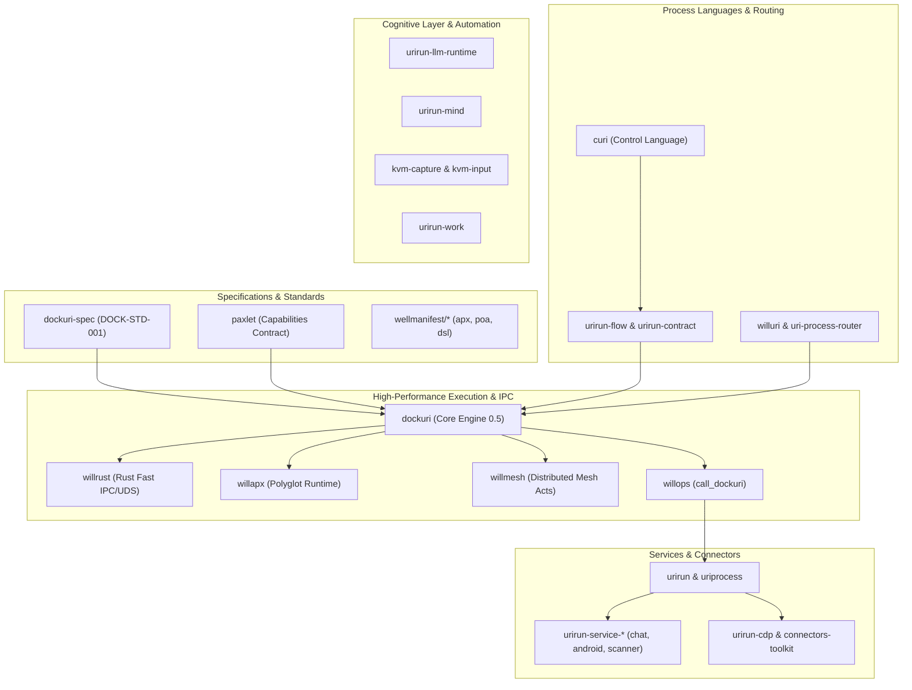

# ⚡ Dockuri Framework

> **Deterministic, Zero-Cold-Start Capability Execution & Process Pipelining Mesh**  
> Implementing the **Wellmanifest Dockuri Standard (DOCK-STD-001)** for heterogeneous, polyglot software components.

---

## 🏛️ Overview & Architecture

Dockuri enables ultra-fast (<2.0 ms latency) composition, routing, and execution of discrete functions, capabilities, and agents across disparate programming languages (Python, Rust, Node.js, PHP, Go, C/C++) through persistent hot daemons, Unix Domain Sockets (UDS), and Zero-Copy Shared Memory (SHM).

---

## 📦 Repository Catalog

The Dockuri ecosystem is structured into distinct, modular layers:

### 1. Specification, Standard & Laboratory

| Repository | Scope | Description |
|---|---|---|
| [`dockuri-spec`](https://github.com/dockuri/dockuri-spec) | Specification | Official Wellmanifest Dockuri Standard (`DOCK-STD-001`), JSON Schemas, and conformance test harness. |
| [`dockuri`](https://github.com/dockuri/dockuri) | Core Framework | Central reference implementation of the Dockuri framework (v0.5), IPC routers, policy gates, and runtime drivers. |
| [`dockuri-meta`](https://github.com/dockuri/dockuri-meta) | Meta & Strategy | Strategy selection, autonomy optimization, and offline policy experimentation lab. |
| [`dockuri-ecosystem`](https://github.com/dockuri/dockuri-ecosystem) | Integration Lab | Unified integration environment uniting Dockuri 0.5, Mesh Acts, Willman, and Policy DSL. |
| [`paxlet`](https://github.com/dockuri/paxlet) | Capabilities | Foundation contract packaging resources and actions into addressable capabilities with cryptographic receipts. |

---

### 2. Process Languages, Routers & Contracts

| Repository | Scope | Description |
|---|---|---|
| [`curi`](https://github.com/dockuri/curi) | Language | CURI (Computer-Use Resource Interface) — resolve-first control process language (`.curi` + `curictl`). |
| [`willuri`](https://github.com/dockuri/willuri) | NLP Router | Natural language to specialized URI process router powered by domain-specific lightweight LLMs. |
| [`uri-process-router`](https://github.com/dockuri/uri-process-router) | Routing Engine | Dynamic routing, protocol dispatch, and worker mapping for URI-based procedures. |
| [`urirun-flow`](https://github.com/dockuri/urirun-flow) | DAG Composition | Typed Python (Pydantic / YAML) authoring for declarative process pipelines and DAG execution. |
| [`urirun-contract`](https://github.com/dockuri/urirun-contract) | Contracts | Route contracts for connectors: output shapes, effect classes, reversibility, and composition wires. |

---

### 3. High-Performance Execution & Native Engines

| Repository | Scope | Description |
|---|---|---|
| [`willrust`](https://github.com/dockuri/willrust) | Native Engine | High-performance Rust-native execution engine for low-latency IPC (<2.0 ms), Unix Domain Sockets, and Zero-Copy Shared Memory (`/dev/shm`). |
| [`willapx`](https://github.com/dockuri/willapx) | Runtime Manager | Polyglot multi-project application runtime manager implementing the Wellmanifest APX standard. |
| [`willops`](https://github.com/dockuri/willops) | Domain Operations | AST-discoverable companion tools and operations, including `call_dockuri` and `run_dockuri_plan`. |
| [`willmesh`](https://github.com/dockuri/willmesh) | Distributed Mesh | Resilient distributed mesh network, durable acts (Mesh Acts), checkpoints, and verified outcomes. |
| [`meshsync`](https://github.com/dockuri/meshsync) | Mesh Synchronizer | REST Git DVCS mesh synchronizer for distributed agent clusters and nodes (<5ms response time). |
| [`meshsync-sandbox`](https://github.com/dockuri/meshsync-sandbox) | Sync Sandbox | Isolated testbench and correctness verification sandbox for mesh synchronization. |
| [`procache`](https://github.com/dockuri/procache) | Process Cache | Provider-neutral SQLite WAL response cache with rate-limit cooldown for read-side API workloads. |
| [`process-identity`](https://github.com/dockuri/process-identity) | Process Capsule | Process identity tracking, execution capsules, and runtime container isolation. |
| [`planfile-orchestration`](https://github.com/dockuri/planfile-orchestration) | Plan Orchestrator | Deterministic Planfile ticket mechanics, DAG runner, and multi-agent workflow orchestration. |
| [`urirun-work`](https://github.com/dockuri/urirun-work) | Scheduler | Parallel work scheduler for independent execution lanes, declared locks, and worker pools. |

---

### 4. Cognitive Layer, Computer-Use & Diagnostics

| Repository | Scope | Description |
|---|---|---|
| [`urirun-llm-runtime`](https://github.com/dockuri/urirun-llm-runtime) | LLM Runtime | Canonical LLM-facing URI process runtime, executor, and schema verification gates. |
| [`urirun-mind`](https://github.com/dockuri/urirun-mind) | Memory & Strategy | Cognitive layer over connectors: episodic memory, skill cards, antipatterns, and strategy reflection. |
| [`kvm-capture`](https://github.com/dockuri/kvm-capture) | Visual Observation | Single-exporter display capture package for low-latency visual verification in computer-use processes. |
| [`kvm-input`](https://github.com/dockuri/kvm-input) | Input Automation | Single-exporter input injection package (keyboard & mouse) for computer-use automation. |
| [`willbench`](https://github.com/dockuri/willbench) | Latency Benchmarks | Repeatable, correctness-gated performance measurements and latency diagnostics (<2.0 ms budget). |
| [`willman-benchmark`](https://github.com/dockuri/willman-benchmark) | Autonomous Benchmarks | Autonomous benchmarking, evaluation, and feedback-loop harness for execution engines. |

---

### 5. Runtime Adapters, Services & Packaging

| Repository | Scope | Description |
|---|---|---|
| [`urirun`](https://github.com/dockuri/urirun) | Core Adapter | Language-agnostic URI to handler adapter and runtime execution core. |
| [`uriprocess`](https://github.com/dockuri/uriprocess) | Process Packages | Monorepo of versioned native Python connector packages and POA process packages. |
| [`uripack`](https://github.com/dockuri/uripack) | Package Toolkit | Contract-first, guard-mediated extraction and packaging toolkit for URI process packages. |
| [`urirun-cdp`](https://github.com/dockuri/urirun-cdp) | Browser Primitive | Chrome DevTools Protocol surface primitive for headless and remote browser automation. |
| [`urirun-connectors-toolkit`](https://github.com/dockuri/urirun-connectors-toolkit) | Connector SDK | Authoring toolkit for connectors (SDK, lint, scaffolding, smoke testing, and catalog verification). |
| [`urirun-service-chat`](https://github.com/dockuri/urirun-service-chat) | Chat Service | Standalone chat and operator dashboard service (port 8194). |
| [`urirun-service-android-node`](https://github.com/dockuri/urirun-service-android-node) | Android Relay | Android relay and mobile device webpage-node service (port 8195). |
| [`urirun-service-scanner`](https://github.com/dockuri/urirun-service-scanner) | Scanner Service | Standalone document scanning and optical intake service (port 8196). |

---

## 📐 Standards Compliance

Dockuri implements and enforces:
- **`DOCK-STD-001`**: Wellmanifest Dockuri Standard.
- **`wellmanifest/apx`**: Application Packaging & Execution Specification.
- **`wellmanifest/poa`**: Process Orchestration Attestation (POA).
- **`wellmanifest/uriprocess`**: Canonical URI Process Architecture.
- **`wellmanifest/wellman`**: `CompositeExecutionReceipt` (`wellmanifest.wellman/receipt/v1`).
- **`wellmanifest/new-project`**: Worktrees v5, strict branch hygiene, and governance gates (`wellman check`).
